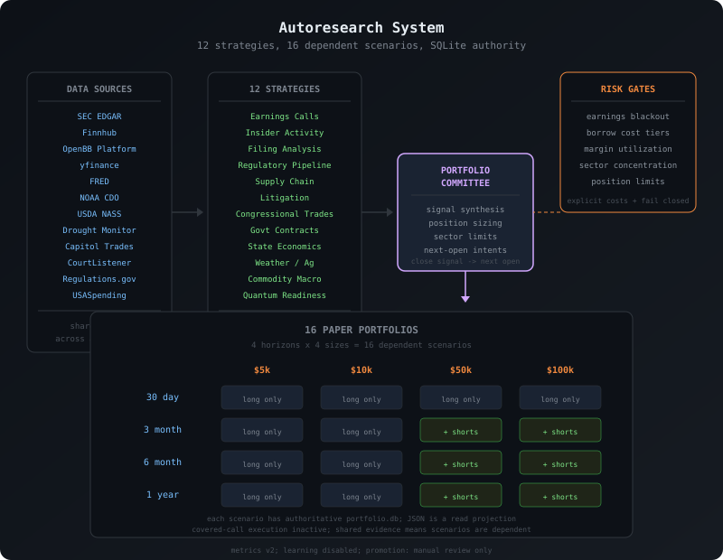
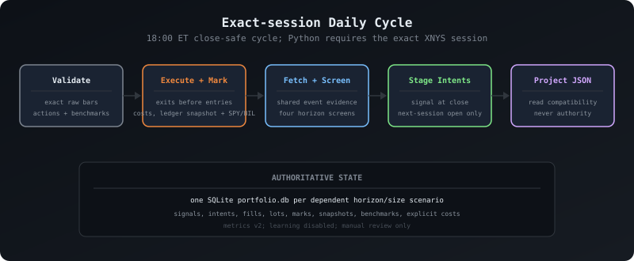

# EventEdge

An autonomous event-driven paper-trading research system (`gen_003`) running 5 active strategies across 16 dependent portfolio scenarios (4 time horizons × 4 portfolio sizes). This is a personal research project.

## What it does

Strategies screen macro, agricultural, federal contract, earnings, and supply-chain events at the market close. An LLM portfolio committee synthesizes one horizon-level decision per time horizon (4 calls per session), and a deterministic portfolio policy sizes and stages next-session-open orders across the 16 scenario books.

<p align="center">
  
</p>

## Strategy coverage

`gen_003` enables 5 event-driven strategies defined in `ACTIVE_STRATEGIES` (`tradingagents/strategies/config.py`):

- **`earnings_call`**: Earnings calendar surprises and news/estimate clustering, prioritized deterministically by EPS surprise magnitude, liquidity/market cap, recency, and symbol hash (never alphabetically). Valid numeric EPS surprises are retained even when news count is zero (`numeric_surprise_only`).
- **`supply_chain`**: Company news and peer spillover hypotheses across a configurable 25-bellwether universe (`DEFAULT_SUPPLY_CHAIN_UNIVERSE`).
- **`govt_contracts`**: New federal contract awards from USASpending, attributed strictly through a hash-pinned 12-character UEI crosswalk (`config/govt_contracts_uei_crosswalk.json`). Unresolved or substring-only matches remain `journal_only`.
- **`weather_ag`**: NOAA daily weather anomalies (22 primary Corn Belt ASOS stations, active April–September and explicitly `off_season_skipped` October–March), USDA NASS crop conditions, and US Drought Monitor severity.
- **`commodity_macro`**: CFTC Commitments of Traders (COT) positioning extremes and FRED macro regime alignment.

**Retired strategies:** `congressional_trades`, `litigation`, `filing_analysis`, `insider_activity`, `quantum_readiness`, `regulatory_pipeline`, and `state_economics` are retired in `gen_003`.

## Data sources

`gen_003` uses 9 direct source integrations plus optional enrichment, with no OpenBB SDK dependency (`tradingagents/strategies/orchestration/_io.py`, `tradingagents/strategies/data_sources/registry.py`):

- **Tier-1 accounting & execution (fail-closed):**
  - **Alpaca SIP (`alpaca_sip`)**: Primary raw daily bars (`feed=sip`, `adjustment=raw`), requiring session close + 15 minutes and validating symbol, session timestamp, pagination, OHLC, finite volume, and positive trade count. Zero-activity, invalid, or missing bars fail closed with no Yahoo fallback.
  - **Yahoo Actions & Benchmarks (`yfinance_actions_benchmarks`)**: Corporate actions (splits and dividend terms) and dividend-adjusted benchmark total-return closes (`SPY`, `BIL`, `VTI`, `VT`).
- **Tier-2 strategy sources (per-strategy circuit breakers):**
  - **Finnhub (`finnhub`)**: Earnings calendar, company news, and company peers under bounded rate-limit/retry policy.
  - **Yahoo Research (`yfinance_research`)**: Research price history and VIX/macro context for the 13 core live tickers (`SPY`, `SHY`, `TLT`, plus 10 `weather_ag` tickers).
  - **USASpending (`usaspending`)**: Federal `new_awards_only` obligations and recipient UEIs.
  - **NOAA (`noaa`)**: NCEI Access v1 daily summaries (`TMAX`, `TMIN`, `PRCP`) for 22 Corn Belt ASOS stations during the April–September growing season.
  - **USDA NASS (`usda`)**: Weekly crop condition progress across corn, soybeans, and wheat.
  - **US Drought Monitor (`drought_monitor`)**: State-level categorical drought severity.
  - **CFTC COT (`cftc`)**: Commitments of Traders ZIP archives with direct `As_of_Date_in_Form_YYYY-MM-DD` validation.
  - **FRED (`fred`)**: Macro time series with vintage awareness, executed in killable subprocesses under absolute deadlines.
- **Tier-2 optional enrichment (`EnrichmentSource`):**
  - **Yahoo Profiles (`yfinance_profile`)**: Direct company profile metadata.
  - **FINRA Short Interest (`finra_short_interest`)**: Direct FINRA Query API short-interest data with dynamic `settlementDate` freshness validation.
  - **Ken French (`ken_french`)**: Optional factor context.

## Models and transport

`gen_003` defaults to `chatgpt_plan` OAuth transport (`chatgpt_plan_auth_path`, defaulting to `/opt/data/private/eventedge/credentials/plan-auth.json` in `config/profiles/gen003-clean.json`), running in a bounded `TransportWorkerPool` (`tradingagents/strategies/transport_worker.py`) with hard `SIGKILL` wall-clock timeouts and SSE metadata hardening:

- **`gpt-6.2-sol` (`high` effort)**: Unstructured thesis analysis and 1-call-per-horizon portfolio committee synthesis (`PortfolioCommittee.synthesize_horizon()`, 4 committee calls per session).
- **`gpt-6-luna` (`high` effort)**: Bounded structured assessments for `commodity_macro` and `weather_ag`.

Model roles, effort levels, and strategy/risk parameters are frozen per generation via `GenerationConfig` (`tradingagents/strategies/config.py`). Production automated learning is disabled.

## Storage, execution, and fault isolation

- **Unified SQLite storage:** Each generation stores all authoritative state in a single WAL-mode `generation.sqlite3` (`tradingagents/strategies/state/generation_db.py`), separating 14 shared once-per-session tables (`signals`, `marks`, `corporate_actions`, `outcomes`, `bar_recoveries`, `candidate_input_issues`, etc.) from 17 cohort-scoped tables indexed by `cohort_id`. Readers snapshot state safely via `sqlite3.Connection.backup()`.
- **Tier-1 vs. Tier-2 fault isolation:** Tier-1 accounting/execution (`SessionExecutor`, `alpaca_sip`, `yfinance_actions_benchmarks`) fails closed on missing or inconsistent evidence. Tier-2 research/enrichment failures trigger per-strategy circuit breakers (`evaluate_strategy_circuit_breaker()`), marking only affected strategies `unavailable` without aborting sibling strategies or invalidating portfolio accounting.
- **T+1 execution and open trimming:** Close-observed signals stage intents for the next exact XNYS session open. Prior exits and open-gap stops settle before new entries. If a T+1 open fill price (including 10 bps adverse slippage) exceeds allowed notional while the overnight gap is within `max_open_chase_pct` (5%), `ExecutionBridge` deterministically trims `fill_qty` down to the allowed notional (rejecting if `fill_qty < 1` or gap > 5%).
- **Worker IPC and evidence:** `scripts/run_cohorts.py` passes structured JSON outcomes via `--result-file` atomically, decoupled from stdout/stderr. Worker attempt logs are archived under `data/logs/run_attempts/` with log-only secret redaction (`run_evidence.py`).
- **Forward-test protocol:** The primary portfolio is `horizon_3m_size_100k` ($100k, 3-month horizon); the remaining 15 books are dependent sensitivity scenarios. The [forward-test protocol](docs/research/2026-10-09-forward-test-protocol.md) fixes 30/60/90-session diagnostic readouts and requires at least 252 valid out-of-sample returns against `SPY` (with `VTI`, `VT`, and `BIL` comparisons) before any strong alpha claim.

<p align="center">
  
</p>

## Setup and operations

```bash
git clone <this repo>
cd <repo>
pip install .            # or pip install -e . for development
cp .env.example .env     # configure API keys (Alpaca SIP, Finnhub, FRED, USDA, etc.)
```

Key operational commands:

```bash
# Daily run for all active generations (validates exact XNYS session)
python scripts/run_generations.py run-daily --date 2026-07-31

# Governed preflight gate (verifies Alpaca SIP and accounting readiness without writing state)
python scripts/run_generations.py preflight --date 2026-07-31 --preflight-mode governed

# Read-only operational report for all active generations
python scripts/generate_operational_report.py --repo-root /path/to/repo \
  --all-active --date 2026-07-31 --output-dir /path/to/repo/docs/reports

# Start, list, pause, resume, or retire a generation
python scripts/run_generations.py start "description of what changed"
python scripts/run_generations.py list

# Compare two generations side-by-side
python scripts/run_generations.py compare \
  --pair gen_004:horizon_3m_size_100k:candidate_epoch_id,gen_003:horizon_3m_size_100k:baseline_epoch_id

# Check five consecutive XNYS sessions in a generation (read-only)
python scripts/check_generation_readiness.py --repo /path/to/production/repo \
  --generation gen_003 --expected-commit FULL_40_CHARACTER_SHA \
  --through 2026-09-21

# Streamlit dashboard and HTML email snapshot
python -m streamlit run tradingagents/dashboard/app.py
python scripts/email_dashboard.py
```

See [AUTORESEARCH_ARCHITECTURE_MAP.md](AUTORESEARCH_ARCHITECTURE_MAP.md) for the module-level architecture map and [docs/gen003-architecture.md](docs/gen003-architecture.md) for the `gen_003` operator runbook.
